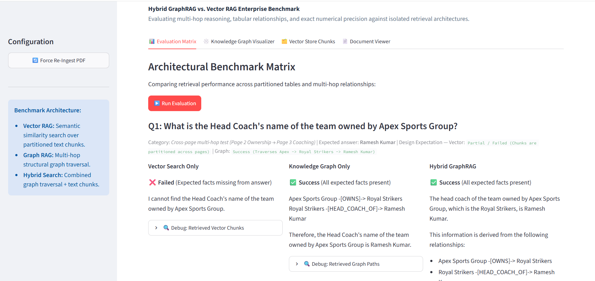
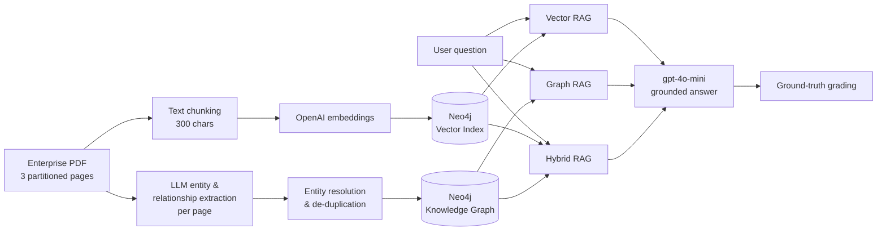

# Hybrid GraphRAG vs. Vector RAG - Enterprise Retrieval Benchmark

**A side-by-side benchmark that shows where vector search succeeds, where knowledge graphs succeed, and why a hybrid of the two gives the most reliable answers on enterprise documents.**




---

## Demo

https://github.com/user-attachments/assets/c9a622c9-dd29-427c-a7dd-c1e85f9868b9

---

## Why This Matters

Most enterprise Retrieval-Augmented Generation (RAG) systems rely only on **vector similarity search**. That works well for "find the passage that says X" questions, but it breaks down when:

- the answer is **spread across several pages or sections** (for example, ownership is on one page and staffing on another),
- the question needs **multi-hop reasoning** across a chain of entities (A funds B, B founded C, so who is behind C?), or
- the source facts sit in **tables** that chunking separates from their headers.

**Knowledge-graph retrieval (GraphRAG)** follows explicit relationships between entities, so it handles these cases well. However, it often drops the exact figures, such as decimals, financial amounts and statistics, that vector search keeps intact.

This project measures that trade-off directly. It runs the same questions through three retrieval strategies against one document and grades each answer against a known ground truth.

---

## Results

Results from the current build, using `gpt-4o-mini` for both answers and graph extraction:

| # | Benchmark question | What it tests | Vector RAG | Graph RAG | **Hybrid** |
|---|---|---|:---:|:---:|:---:|
| Q1 | Who is the head coach of the team owned by Apex Sports Group? | Cross-page multi-hop (ownership → coaching) | ❌ | ✅ | ✅ |
| Q2 | What was Arjun Mehra's exact strike rate and number of sixes? | Exact numeric precision from a table | ✅ | ❌ | ✅ |
| Q3 | Which organization is the primary financial backer of the institute that founded the Metro Warriors? | Deep corporate hierarchy (3 entities) | ✅ | ✅ | ✅ |
| Q4 | Who presented the trophy to Arjun Mehra, and what was the Meridian Corp grant allocation? | Cross-entity financial linkage | ✅ | ✅ | ✅ |

**Key takeaway:** each single strategy has a blind spot. Vector search loses relationships that span pages, and graph search loses exact numbers. **Hybrid retrieval answered all four questions correctly.**

> Graph extraction is performed by an LLM, so individual results may vary slightly between ingestion runs.

---

## How It Works



| Strategy | Retrieval method | Strength | Weakness |
|---|---|---|---|
| **Vector RAG** | Top-k semantic similarity over text chunks | Exact figures, verbatim facts | Facts split across chunks or pages |
| **Graph RAG** | Keyword-anchored traversal (up to 2 hops), returned as directed `Source -[RELATION]-> Target` triples | Multi-hop relationships, entity chains | Numeric attributes and tabular detail |
| **Hybrid RAG** | Both contexts combined in a single grounded prompt | Combines both strengths | Larger prompt context |

### The benchmark document

[`assets/2026_inter_city_cricket_championship_enterprise_report.pdf`](assets/2026_inter_city_cricket_championship_enterprise_report.pdf) is a synthetic enterprise dossier. It is deliberately split into three pages so that no single passage holds a complete answer:

| Page | Content | Role in the benchmark |
|---|---|---|
| 1 | Match summary & player statistics table | Tests numeric precision |
| 2 | Corporate ownership & financial register | Tests ownership and funding chains |
| 3 | Coaching directory & award presentation log | Tests cross-page linkage |

### Grading

Each answer is graded automatically against the facts it must contain, rather than on whether the model sounded confident:

- ✅ **Success**: all expected facts are present
- ⚠️ **Partial**: some expected facts are present
- ❌ **Failed**: no expected facts are present

---

## Application Features

| View | Purpose |
|---|---|
| **Evaluation Matrix** | Runs the benchmark when you click **Run Evaluation** and shows the three strategies side by side. Each answer has an expandable panel with the exact context that was retrieved. |
| **Knowledge Graph Visualizer** | Renders the extracted entity-relationship graph. |
| **Vector Store Chunks** | Lists every indexed text chunk so you can see how the document was split. |
| **Document Viewer** | Shows the source PDF in an embedded, scrollable viewer. |

A **Force Re-Ingest** control in the sidebar rebuilds both the vector index and the knowledge graph from scratch.

---

## Getting Started

### Prerequisites

- Python 3.10 or later (tested on 3.13)
- A Neo4j 5.x database. [Neo4j AuraDB Free](https://neo4j.com/cloud/aura-free/) is sufficient.
- An OpenAI API key
- [Graphviz](https://graphviz.org/download/) installed on the system, for the graph visualizer

### Installation

```bash
python -m venv .venv
# Windows
.venv\Scripts\activate
# macOS / Linux
source .venv/bin/activate

pip install -r requirements.txt
```

### Configuration

Create a `.env` file in the project root:

```env
OPENAI_API_KEY=sk-...
NEO4J_URI=neo4j+s://<your-instance>.databases.neo4j.io
NEO4J_USERNAME=neo4j
NEO4J_PASSWORD=<your-password>
NEO4J_DATABASE=neo4j
```

> ⚠️ Ingestion **wipes the target Neo4j database** before re-indexing. Use a dedicated instance.

### Run

```bash
streamlit run app.py
```

On first launch, the app ingests the benchmark PDF automatically. Open the **Evaluation Matrix** tab and click **Run Evaluation**.

---

## Project Structure

```
hybrid_graph_vector_rag_demo/
├── app.py                  # Streamlit dashboard and benchmark definitions
├── requirements.txt
├── assets/
│   ├── 2026_inter_city_cricket_championship_enterprise_report.pdf
│   ├── demo.png
│   └── demo.mp4
└── src/
    ├── db_manager.py       # Ingestion: chunking, embeddings, graph extraction, entity resolution
    └── rag_engine.py       # Retrieval and answer generation for vector, graph and hybrid modes
```

---

## Technology Stack

| Layer | Technology |
|---|---|
| Interface | Streamlit |
| Orchestration | LangChain, LangChain Experimental (`LLMGraphTransformer`) |
| Storage | Neo4j: a single database for both the vector index and the knowledge graph |
| Models | OpenAI `gpt-4o-mini` (generation & extraction), `text-embedding-3-small` (embeddings) |
| Document parsing | PyPDF |

---

## Extending the Benchmark

To add a question, append an entry to `EVAL_QUESTIONS` in [`app.py`](app.py):

```python
{
    "id": "Q5",
    "question": "Your question here?",
    "type": "What capability this tests",
    "expected_vector": "Expected vector outcome",
    "expected_graph": "Expected graph outcome",
    "expected_answer": "Human-readable ground truth",
    "expected_patterns": [r"regex for fact 1", r"regex for fact 2"],
}
```

To benchmark your own document, replace the PDF in `assets/`, update `pdf_path` in `app.py`, and adjust `allowed_nodes` / `allowed_relationships` in [`src/db_manager.py`](src/db_manager.py) to fit your domain.

---

## Disclaimer

The benchmark document is **synthetic**. All organizations, people and figures in it are fictional and exist only to evaluate retrieval behaviour.
